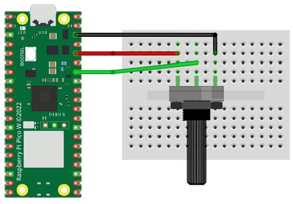

# Analogue Input with Potentiometers

The analogue input pins on the Raspberry Pi Pico can be used to read an analogue value ranging from 0 to 65535.

A potentiometer is a variable resistor that can adjust a voltage from 0 V to the maximum circuit voltage. By reading this voltage, we can control other things, such as volume, light, and movement. The reading is analogue, meaning it can vary continuously between the minimum and maximum values.

## Wire Up

Connect the potentiometer to the Raspberry Pi Pico as shown below.



| Wire colour | Raspberry Pi Pico connection |
|:---|:---|
| Black | GND |
| Red | 3V3 |
| Green | GP28 or another suitable analogue input pin |

## Code

Enter the following code and run it on the Pico using CircuitPython.

You can also view the [potentiometer example on GitHub](https://github.com/lewfer/recipes-rpi-pico-circuitpython/blob/master/test_potentiometer.py).

```python
# Test Potentiometer

import time
import board
import analogio

# Set up the potentiometer on pin 28 as an analogue input pin
pot = analogio.AnalogIn(board.GP28_A2)

# The value ranges from 0 to 65535.
# The direction of increase or decrease depends on the wiring.
while True:
    val = pot.value
    print(val)
    time.sleep(0.2)
```

Turn the knob on the potentiometer. The values printed in the Thonny shell should change as you rotate it.
