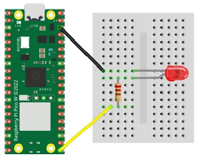
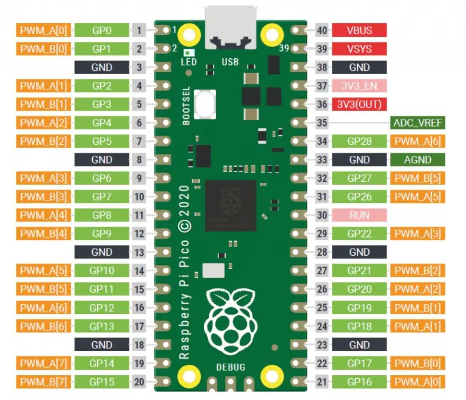

# Analogue Output with LEDs

The PWM pins on the Raspberry Pi Pico can be used to control an output from fully off (`0`) to fully on (`65535`).

We will use an LED to demonstrate analogue-style output. As the PWM value increases from `0` to `65535`, the brightness of the LED will increase.

## PWM (Pulse Width Modulation)

The Raspberry Pi Pico cannot produce a true analogue output. In other words, it cannot continuously vary the voltage on an output pin. It can only provide a digital output.

However, it can simulate analogue control using a technique called **Pulse Width Modulation (PWM)**.

PWM switches a digital signal on and off very quickly. By changing the relative amount of time the signal stays on and off, we can control the brightness of an LED.

All general-purpose (GP) pins on the Raspberry Pi Pico can provide a PWM signal.


## Wire Up

Connect the LED to the Raspberry Pi Pico using a **220-ohm resistor**. The resistor limits the current and helps prevent damage to the LED.

This circuit is similar to the one used for digital LED control.



### Wiring Table

| Circuit Wire | Raspberry Pi Pico Pin |
|---|---|
| Black | GND |
| Yellow | GP16 or another suitable GP pin |

## Code

Write the following CircuitPython code and download it to the Raspberry Pi Pico. The LED brightness should gradually increase from off to full intensity.

See the [LED PWM example on GitHub](https://github.com/lewfer/recipes-rpi-pico-circuitpython/blob/master/test_led_pwm.py).

```python
# Test PWM brightness control on an LED

import time
import board
import pwmio

# Set up the LED on pin GP13 as a PWM output
led = pwmio.PWMOut(board.GP13, frequency=1000)

# Continuously adjust the LED brightness
# 0 = off and 65535 = full brightness
while True:
    for brightness in range(0, 65535, 1000):
        led.duty_cycle = brightness
        time.sleep(0.1)
```

### Code Explanation

- `import time`: Allows the program to pause between brightness changes.
- `import board`: Provides access to the Raspberry Pi Pico's pin names.
- `import pwmio`: Enables PWM output.
- `pwmio.PWMOut(board.GP13, frequency=1000)`: Configures GP13 to generate a PWM signal at 1,000 Hz.
- `led.duty_cycle = brightness`: Sets the PWM duty cycle to control LED brightness.
- `time.sleep(0.1)`: Pauses for 0.1 seconds between changes.

The program increases the brightness in small steps, creating a gradual brightening effect. When the loop reaches its end, it starts again from zero.

**Important:** The wiring table specifies GP16, while the example code uses GP13. Connect the yellow wire to **GP13** if you use the code exactly as written, or change the code to `board.GP16` if you wire the LED to GP16. Always use a suitable current-limiting resistor.

## Note on PWM Pin Usage

Because of the way PWM channels are connected internally, certain pairs of pins cannot be used for independent PWM outputs at the same time.

In the diagram below, pins with the same PWM letter and number share a PWM channel. For example, you cannot use both pins labelled `PWM_A[0]` simultaneously for separate PWM functions that require independent control.


```
