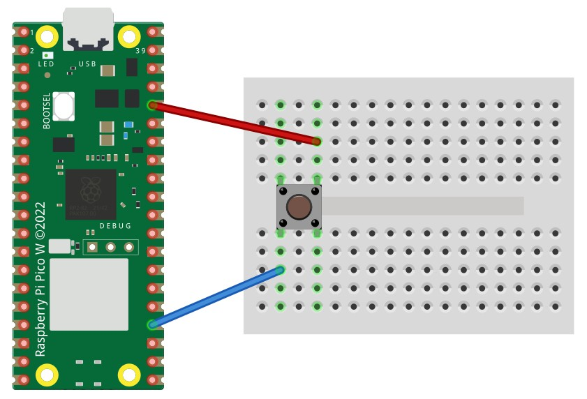
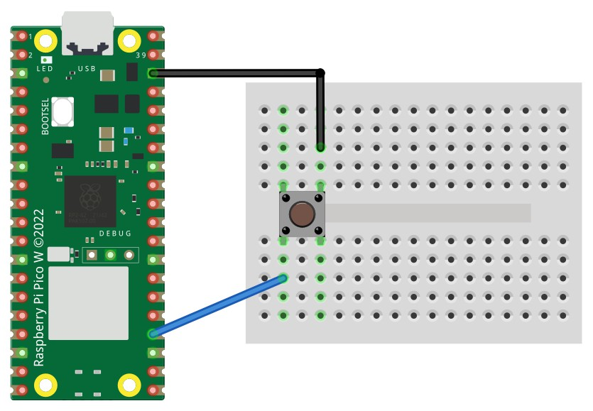

# Digital Input with Buttons

The digital input pins on the Raspberry Pi Pico can be used to read the state of a digital device, such as a button.

Buttons and switches come in various shapes and sizes. In this guide, we will use simple momentary push buttons that fit nicely into a breadboard.

## Wire Up (Pull Down)

Connect the button to a breadboard as shown below.



| Wire colour | Raspberry Pi Pico connection |
|:---|:---|
| Red | 3V3 |
| Blue | GP18 or another suitable GPIO pin |

## Code (Pull Down)

Enter the following code and run it on the Pico using CircuitPython. The output will change according to whether the button is pressed.

You can also view the [button pull-down example on GitHub](https://github.com/lewfer/recipes-rpi-pico-circuitpython/blob/master/test_button_pull_down.py).

```python
# Test button input (button connected to 3V3)

import board
from digitalio import DigitalInOut, Direction, Pull
import time

# Set up the button on pin 18 as a digital input pin
switch = DigitalInOut(board.GP18)
switch.direction = Direction.INPUT
switch.pull = Pull.DOWN  # Pull down so button value is True when pressed

# Show the button status (True is pressed, False is not pressed)
while True:
    print(switch.value)
    time.sleep(0.01)
```

The circuit and code above use the **pull-down** approach. The input defaults to `False` when the button is not pressed and changes to `True` when the button is pressed and the connection to 3V3 is made.

## Wire Up (Pull Up)

An alternative is the pull-up approach. Connect the button to a breadboard as shown below.



| Wire colour | Raspberry Pi Pico connection |
|:---|:---|
| Black | GND |
| Blue | GP18 or another suitable GPIO pin |

## Code (Pull Up)

Enter the following code and run it on the Pico using CircuitPython. The output will change according to whether the button is pressed.

```python
# Test button input (button connected to ground)

import board
from digitalio import DigitalInOut, Direction, Pull
import time

# Set up the button on pin 18 as a digital input pin
switch = DigitalInOut(board.GP18)
switch.direction = Direction.INPUT
switch.pull = Pull.UP  # Pull up so button value is True when not pressed

# Show the button status (False is pressed, True is not pressed)
while True:
    print(switch.value)
    time.sleep(0.01)
```

With the **pull-up** approach, the input defaults to `True` when the button is not pressed. When you press the button, the connection to GND makes the input change to `False`.
