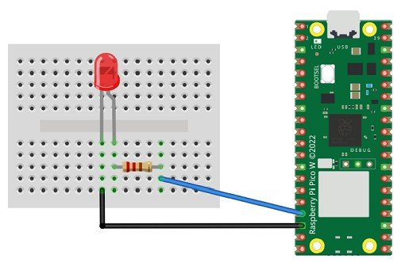

# Digital Output with LEDs

The digital output pins on the Raspberry Pi Pico can be used to turn a device, such as an LED, on or off.

LEDs are small lights that come in a variety of sizes and colours. LED stands for Light Emitting Diode.

Diodes only allow electricity to flow in one direction, so we need to connect the LED the correct way around. Otherwise, it will not light up. The short leg should connect to ground (GND), and the long leg should connect to the digital signal through a resistor.

## Wire Up

Connect the LED using a 220-ohm resistor as shown below. The resistor limits the current flowing through the LED and helps prevent it from burning out.



| Wire colour | Raspberry Pi Pico connection |
|:---|:---|
| Black | GND |
| Blue | GP13 or another suitable GPIO pin |

## Code

Enter the following code in your CircuitPython editor and save it to the Raspberry Pi Pico. The LED should flash continuously.

You can also view the [LED blinking example on GitHub](https://github.com/lewfer/recipes-rpi-pico-circuitpython/blob/master/test_led_blink.py).

```python
# Test blinking of an LED

import time
import board
import digitalio

# Set up the LED on pin 13 as a digital output pin
led = digitalio.DigitalInOut(board.GP13)
led.direction = digitalio.Direction.OUTPUT

# Loop forever, blinking the LED
while True:
    led.value = True
    time.sleep(0.5)
    led.value = False
    time.sleep(0.5)
```
