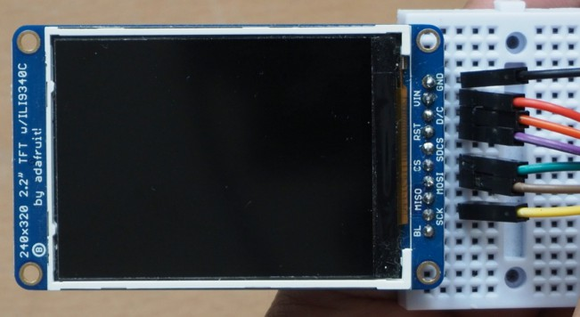
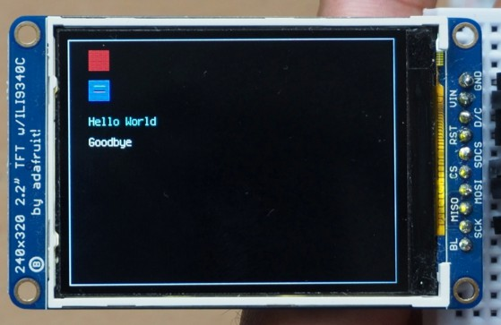
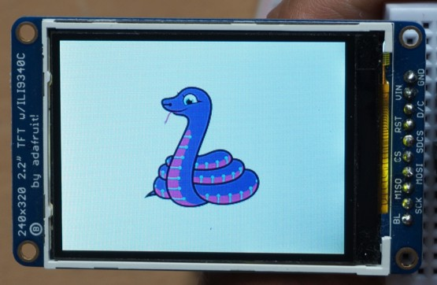

# Adafruit 2.2in TFT Display

This colour display can show images, text and graphics.

The Adafruit 2.2 inch TFT display can has a resolution of 320x240 pixlels in 18-bit colour.

## Wire Up

Connect the display as follows:



| **Display** | **Pico** |
| :--- | :--- |
| **VCC** | 3V |
| **GND** | GND |
| **SCK** | GP10 (SPI1 SCK) |
| **SI or MOSI** | GP11 (SPI1 TX) |
| **TCS or CS** | GP13 (SPI1 CS) |
| **RST** | GP17 |
| **DC** | GP16 |

## Add the Library

You need to add the display library. Copy the file **adafruit_ili9341.mpy** and the directory **adafruit_display_text** from the lib directory on github to the lib directory on the pico.

## Code to Display Graphics and Text

Write this code and download to the Pico.

[See code on GitHub](https://github.com/lewfer/recipes-rpi-pico-circuitpython/blob/master/test_tft_22_graphics.py)

```python
# Test display of graphics on TFT 2.2"

import board, busio, displayio, os
import terminalio 
import adafruit_ili9341
from adafruit_display_text import label

# Set up pins
MOSI = board.GP11
SCLK = board.GP10
RESET = board.GP17
CS = board.GP13
DC = board.GP16

# Set up display as an SPI device
displayio.release_displays()
spi = busio.SPI(clock=SCLK, MOSI=MOSI)
display_bus = displayio.FourWire(spi, command=DC, chip_select=CS, reset=RESET)
display = adafruit_ili9341.ILI9341(display_bus, width=320, height=240, rotation=0)

# Create a group on the display
group = displayio.Group()

# Draw rectangles as a border around the display
palette = displayio.Palette(1)
palette[0] = 0xAAAAAA  # grey
bitmap = displayio.Bitmap(1, 240, 1) # tall thin
rect = displayio.TileGrid(bitmap, pixel_shader=palette, x=0, y=0) # top line
group.append(rect)
rect = displayio.TileGrid(bitmap, pixel_shader=palette, x=319, y=0) # bottom line
group.append(rect)
bitmap = displayio.Bitmap(320, 1, 1) # short fat
rect = displayio.TileGrid(bitmap, pixel_shader=palette, x=0, y=0) # left line
group.append(rect)
rect = displayio.TileGrid(bitmap, pixel_shader=palette, x=0, y=239) # right line
group.append(rect)


# Draw a red rectangle and add to the group
bitmap = displayio.Bitmap(20, 20, 1)
palette = displayio.Palette(1)
palette[0] = 0xAA0000  
rect = displayio.TileGrid(bitmap, pixel_shader=palette, x=20, y=10)
group.append(rect)

# Draw a blue rectangle with lines in it and add to the group
bitmap = displayio.Bitmap(20, 20, 3) # 3-colour bitmap
palette = displayio.Palette(3)       # 3- colour palette
palette[0] = 0x0000ff                # blue
palette[1] = 0x00ff00                # green
palette[2] = 0xff0000                # red
rect = displayio.TileGrid(bitmap, pixel_shader=palette, x=20, y=40) # grid with colour 0
for x in range(5, 16):               # line of pixels
    bitmap[x, 5] = 1                 # colour 1
for x in range(5, 16):               # line of pixels
    bitmap[x, 10] = 2                # colour 2
group.append(rect)

# Draw a text label and add it to the group
label1 = label.Label(terminalio.FONT, text="Hello World", color=0x00FFFF)
label1.x = 20
label1.y = 80
group.append(label1)

# Draw a text label and add it to the group
label2 = label.Label(terminalio.FONT, text="Goodbye", color=0xFFFFFF)
label2.x = 20
label2.y = 100
group.append(label2)

# Display the group
display.show(group)

# Loop forever so you can see what you drew
while True:
    pass
```

You should see this graphic:



## Code to Display a Bitmap

Write this code and download to the Pico.

[See code on GitHub](https://github.com/lewfer/recipes-rpi-pico-circuitpython/blob/master/test_tft_144_bitmap.py)

```python
# Test display of bitmap on TFT 2.2"

import board,busio
import adafruit_ili9341
import displayio

# Set up pins
MOSI = board.GP11
SCLK = board.GP10
RESET = board.GP17
CS = board.GP13
DC = board.GP16

# Set up display as an SPI device
displayio.release_displays()
spi = busio.SPI(clock=SCLK, MOSI=MOSI)
display_bus = displayio.FourWire(spi, command=DC, chip_select=CS, reset=RESET)
display = adafruit_ili9341.ILI9341(display_bus, width=320, height=240, rotation=0)

# Setup the file as the bitmap data source
bitmap = displayio.OnDiskBitmap("/blinka_320_240.bmp")

# Create a TileGrid to hold the bitmap
tile_grid = displayio.TileGrid(bitmap, pixel_shader=bitmap.pixel_shader)

# Create a Group to hold the TileGrid
group = displayio.Group()

# Add the TileGrid to the Group
group.append(tile_grid)

# Add the Group to the Display
display.show(group)

# Loop forever so you can enjoy your image
while True:
    pass
```

You should see this image:



## Further Reading

Adafruit Product page: [Adafruit 2.2" TFT with Micro SD Socket](https://learn.adafruit.com/2-2-tft-display/overview)

Reference for the displayio library: [CircuitPython Display Support Using displayio](https://learn.adafruit.com/circuitpython-display-support-using-displayio/introduction)

## Buy

You can purchase this item from the following stores:

[Cool Components](https://coolcomponents.co.uk/products/2-2-18-bit-color-tft-lcd-display-with-microsd-card-breakout?currency=GBP&variant=45223114318&utm_medium=cpc&utm_source=google&utm_campaign=Google%20Shopping&gclid=Cj0KCQjw6KunBhDxARIsAKFUGs8YwqV98W3ISeyBFiHEA5ntYHfNf6zXP-BHEq_fOKMYCwl1s2W_nHQaAt1qEALw_wcB)

There are also larger versions which have touchscreen capability:

[2.4 inch](https://thepihut.com/products/adafruit-2-4-tft-lcd-with-touchscreen-breakout-w-microsd-socket-ili9341)

[2.8 inch](https://thepihut.com/products/adafruit-2-8-tft-lcd-with-touchscreen-breakout-board-w-microsd-socket)

[3.2 inch](https://thepihut.com/products/adafruit-3-2-tft-lcd-with-touchscreen-breakout-board-w-microsd-socket)

To control the touchscreen you need to add the adafruit_touchscreen.mpy library. See [here](https://docs.circuitpython.org/projects/touchscreen/en/latest/api.html) for details.