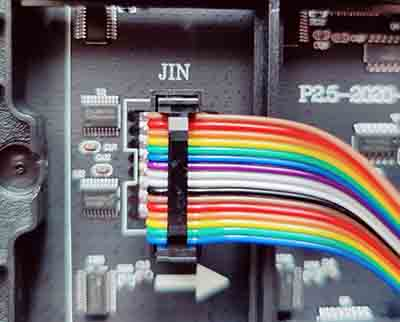
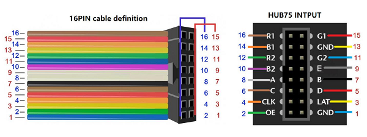
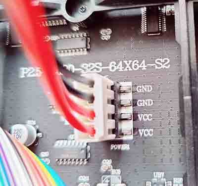
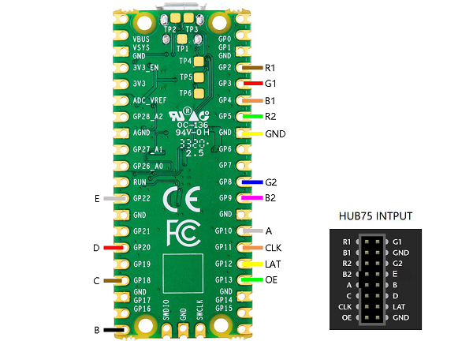
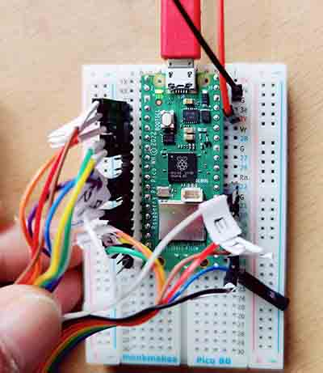
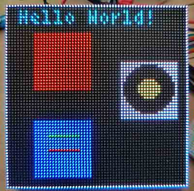

# Waveshare 64x64 Display

A 64x64 multicolour LED Display

A bright multicolour display with a 64x64 resolution

## Preparation

Your pico should be running a version of CircuitPython. See [here](/resources/raspberrypi-pico-recipes/circuitpython) for details.

## Connect the Display

Plug the data cable into the display, making sure the notch on the plug engages with the notch on the socket:



For reference, here is the pinout diagram:



Plug the power cable into the display. **The power source must be 5V**. Any higher and you will destroy the display!



## Connect the Pico

Connect the data wires from the display to the Pico according to the following diagram:



There are a lot of wires!



## Add the libraries

You need to add the Adafruit display libraries. Copy the **adafruit_display_text** and **adafruit_bitmap_font** folders from the lib directory on github to the lib directory on the pico:

## Code

```python
# Test display of graphics on Waveshare 64x64
import board
import displayio
import framebufferio
import rgbmatrix
from digitalio import DigitalInOut,Direction
from adafruit_display_text import label
import terminalio
from adafruit_bitmap_font import bitmap_font
import time
from math import sin

bit_depth_value = 6
unit_width = 64
unit_height = 64
chain_width = 1
chain_height = 1
serpentine_value = True

width_value = unit_width*chain_width
height_value = unit_height*chain_height

# Set up the display
displayio.release_displays()
matrix = rgbmatrix.RGBMatrix(
    width = width_value, height=height_value, bit_depth=bit_depth_value,
    rgb_pins = [board.GP2, board.GP3, board.GP4, board.GP5, board.GP8, board.GP9],
    addr_pins = [board.GP10, board.GP16, board.GP18, board.GP20, board.GP22],
    clock_pin = board.GP11, latch_pin=board.GP12, output_enable_pin=board.GP13,
    tile = chain_height, serpentine=serpentine_value,
    doublebuffer = True)
display = framebufferio.FramebufferDisplay(matrix, auto_refresh=True,rotation=180)

# Create a group on the display
group = displayio.Group()

# Draw rectangles as a border around the display
palette = displayio.Palette(1)
palette[0] = 0xAAAAAA  # grey
bitmap = displayio.Bitmap(1, 64, 1) # tall thin
rect = displayio.TileGrid(bitmap, pixel_shader=palette, x=0, y=0) # top line
group.append(rect)
rect = displayio.TileGrid(bitmap, pixel_shader=palette, x=63, y=0) # bottom line
group.append(rect)
bitmap = displayio.Bitmap(128, 1, 1) # short fat
rect = displayio.TileGrid(bitmap, pixel_shader=palette, x=0, y=0) # left line
group.append(rect)
rect = displayio.TileGrid(bitmap, pixel_shader=palette, x=0, y=63) # right line
group.append(rect)

# Draw a red rectangle and add to the group
bitmap = displayio.Bitmap(20, 20, 1)
palette = displayio.Palette(1)
palette[0] = 0xAA0000  
rect = displayio.TileGrid(bitmap, pixel_shader=palette, x=10, y=10)
group.append(rect)

# Draw a blue rectangle with lines in it and add to the group
bitmap = displayio.Bitmap(20, 20, 3) # 3-colour bitmap
palette = displayio.Palette(3)       # 3- colour palette
palette[0] = 0x0000ff                # blue
palette[1] = 0x00ff00                # green
palette[2] = 0xff0000                # red
rect = displayio.TileGrid(bitmap, pixel_shader=palette, x=10, y=40) # grid with colour 0
for x in range(5, 16):               # line of pixels
    bitmap[x, 5] = 1                 # colour 1
for x in range(5, 16):               # line of pixels
    bitmap[x, 10] = 2                # colour 2
group.append(rect)


bitmap = displayio.OnDiskBitmap(open("image/20x20.bmp", 'rb'))
group.append(displayio.TileGrid(
bitmap,
pixel_shader = getattr(bitmap, 'pixel_shader', displayio.ColorConverter()),
width = 1,
height = 1,
x= 40,
y=20,
tile_width = bitmap.width,
tile_height = bitmap.height))
        
        
# Load a custom font
font = bitmap_font.load_font("font/4x6.bdf")

# Draw a text label and add it to the group
label1 = label.Label(font, text="Hello World!", color=0x00FFFF)
label1.x = 5
label1.y = 5
group.append(label1)

# Display the group
display.show(group)

# Loop forever so you can see what you drew
while True:
    pass
```

You should see this graphic:



## Reference

A full reference for this display can be found on the WaveShare website:

[Working With Raspberry Pi Pico](https://www.waveshare.com/wiki/RGB-Matrix-P2.5-64x64#Working_With_Raspberry_Pi_Pico)
