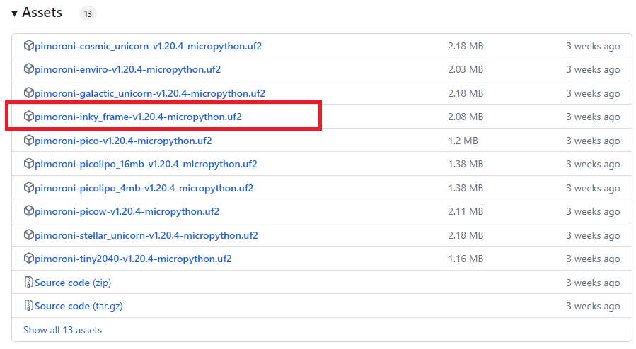
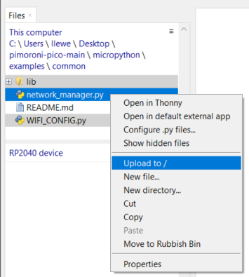
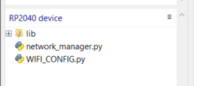
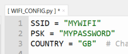
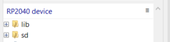
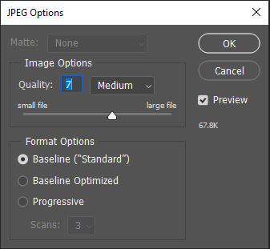

# Pimoroni Inky Frame

This is a 7-colour e-ink display with a built-in Raspberry Pi Pico

E-ink displays are low-power displays that reflect light rather than emit light, giving a paper-like appearance. The images will remain on the display even when the power is switched off. This display from Pimoroni has a built-in Raspberry Pi Pico W.

## Setting Up

The Inky Frame will come with the relevant software and demos already installed, but it is a good idea to wipe the device and reinstall the software to get the latest version.

### 1. Nuke the Pico

Download this UF2 file and copy it to the Pico:

[flash_nuke.uf2](https://datasheets.raspberrypi.com/soft/flash_nuke.uf2)

To do this, with the Pico unplugged from power, press and hold the BOOTSEL button.


Then plug the Pico into your USB cable connected to your computer. You should see the RPI-RP2 drive appear on your computer (use Windows Explorer or Mac Finder to see it), e.g:


Now drag the UF2 file you downloaded to the RPI-RP2 drive. The file will be downloaded to the Pico and the drive will disappear from your computer.

### 2. Install Pimoroni UF2

Now download the latest Inky Frame UF2 file from here:

[Inky Frame UF2](https://github.com/pimoroni/pimoroni-pico/releases)

Make sure to get the inky frame one:



Copy this onto your Pico.

### 3. Install Pimoroni Libraries

Download the Pimoroni Pico sample code from the link below. You will only need a small subset of this, but it's easier to download it all as a .zip to your computer first:

[Pimoroni Pico Code Repository](https://github.com/pimoroni/pimoroni-pico)

Unzip the code to your computer, e.g. to your desktop.

In Thonny, locate the common directory from the unzipped files on your local computer and upload lib, network_manager.py and WIFI_CONFIG.py to your Pico:



Once uploaded you should see these files on the Pico:



Alternatively, I've put these files on my github here:

[Inky Frame files on my github](https://github.com/lewfer/recipes-rpi-pico-micropython/tree/main/pimoroni_inky_frame)

### 4. Connect to your WIFI

Edit the WIFI_CONFIG.py file and enter your WIFI credentials, e.g.



## Display an Image

On the Pico create a file called display_image.py. Enter the following code. Comment/uncomment one of the DISPLAY_INKY_FRAME lines according to the size of your display. Also select the correct cow image for your display.

[See code on github](https://github.com/lewfer/recipes-rpi-pico-micropython/blob/main/pimoroni_inky_frame/display_image.py)

```python
# Example to show displaying an image on the Inky Frame

# Select the correct library for your screen size: DISPLAY_INKY_FRAME_4 for 4", DISPLAY_INKY_FRAME_7 fo 7.3" and DISPLAY_INKY_FRAME for 5.7"
from picographics import PicoGraphics, DISPLAY_INKY_FRAME_4 as DISPLAY
#from picographics import PicoGraphics, DISPLAY_INKY_FRAME as DISPLAY
#from picographics import PicoGraphics, DISPLAY_INKY_FRAME_7 as DISPLAY

from jpegdec import JPEG

graphics = PicoGraphics(DISPLAY)

# Load the file
j = JPEG(graphics)
j.open_file("cow_4.jpg")
j.decode()

# Display it
graphics.update()

```

Upload the appropriate cow image to the Pico and rename it to cow\.jpg. You can download the images from here:

For 4" display:


For 5.7" display:


For 7.3" display:


Run the code. A picture of a cow should appear.

## Display an Image from the SD Card

Storing images on the Pico will quickly fill up the memory of the Pico. The Inky Frames have an SD card slot. You can load images to and SD card and insert it into the Inky Frame. Then you can display images straight from the SD card.

To mount the SD card, enter and run this code:

[See code on github](https://github.com/lewfer/recipes-rpi-pico-micropython/blob/main/pimoroni_inky_frame/mount_sd_card.py)

```python
# Mount the SD card

# Set up the SD card
import gc
import uos
import sdcard  # noqa: E402 - putting this at the top causes an MBEDTLS OOM error!?
sd_spi = machine.SPI(0, sck=machine.Pin(18, machine.Pin.OUT), mosi=machine.Pin(19, machine.Pin.OUT), miso=machine.Pin(16, machine.Pin.OUT))
sd = sdcard.SDCard(sd_spi, machine.Pin(22))
uos.mount(sd, "/sd")
gc.collect()  # Claw back some RAM!

```

Refresh the files on the Pico in Thonny and you will see the SD card appear:



You can now upload image files to the sd card using Thonny. Upload your cow image to the sd directory.

Now you can run code that reads cow\.jpg from the sd card and displays it:

[See code on github](https://github.com/lewfer/recipes-rpi-pico-micropython/blob/main/pimoroni_inky_frame/display_image_sd_card.py)

```python
# Example to show displaying an image from the SD card on the Inky Frame

# Select the correct library for your screen size: DISPLAY_INKY_FRAME_4 for 4", DISPLAY_INKY_FRAME_7 fo 7.3" and DISPLAY_INKY_FRAME for 5.7"
from picographics import PicoGraphics, DISPLAY_INKY_FRAME_4 as DISPLAY
#from picographics import PicoGraphics, DISPLAY_INKY_FRAME as DISPLAY
#from picographics import PicoGraphics, DISPLAY_INKY_FRAME_7 as DISPLAY

from jpegdec import JPEG

# Set up the SD card
import gc
import uos
import sdcard  # noqa: E402 - putting this at the top causes an MBEDTLS OOM error!?
sd_spi = machine.SPI(0, sck=machine.Pin(18, machine.Pin.OUT), mosi=machine.Pin(19, machine.Pin.OUT), miso=machine.Pin(16, machine.Pin.OUT))
sd = sdcard.SDCard(sd_spi, machine.Pin(22))
uos.mount(sd, "/sd")
gc.collect()  # Claw back some RAM!


graphics = PicoGraphics(DISPLAY)

# Load the file (
j = JPEG(graphics)
j.open_file("/sd/cow.jpg")
j.decode()

# Display it
graphics.update()

```

## Preparing Images for Display

The Inky Frame can display jpg images, but they need to be the right size for your display and be saved using the correct jpg option.

Sizes:

For 4" Inky Frame: 640x400

For 5.7" Inky Frame: 600x448

For 7.3" Inky Frame: 800x480

Format: Turn off progressive option. In Photoshop, when you save the file choose Baseline Standard:



## Call a Web API

The Pico on the Inky Frame is WiFi enables, so you can build some nice projects that pull data from the internet and display it.

This example pulls a random joke from the random joke api and prints it on the console. Note that it does not update the display.

[See code on github](https://github.com/lewfer/recipes-rpi-pico-micropython/blob/main/pimoroni_inky_frame/network_api_call.py)

```python
# Example of how to connect to WiFi and call an API

from network_manager import NetworkManager
import uasyncio
from urllib import urequest
import WIFI_CONFIG
import json
import time

# URL of the API
URL = "https://official-joke-api.appspot.com/random_joke"

# Function to handle status messages
def status_handler(mode, status, ip):
    print(mode, status, ip)
    
# Connect to WiFi
network_manager = NetworkManager(WIFI_CONFIG.COUNTRY, status_handler=status_handler)
uasyncio.get_event_loop().run_until_complete(network_manager.client(WIFI_CONFIG.SSID, WIFI_CONFIG.PSK))

# Call the api
socket = urequest.urlopen(URL)

# Decode the response and display the joke
d = json.load(socket)
print(d["setup"])
time.sleep(1)
print(".")
time.sleep(1)
print(".")
time.sleep(1)
print(d["punchline"])

```

## Draw Text and Shapes

The sample code below can be used to draw text and shapes on the display/

[See code on github](https://github.com/lewfer/recipes-rpi-pico-micropython/blob/main/pimoroni_inky_frame/display_text_graphics.py)

```python
# Example to show drawing text and graphics on the Inky Frame

# from picographics import PicoGraphics, DISPLAY_INKY_FRAME as DISPLAY      # 5.7"
from picographics import PicoGraphics, DISPLAY_INKY_FRAME_4 as DISPLAY  # 4.0"
#from picographics import PicoGraphics, DISPLAY_INKY_FRAME_7 as DISPLAY  # 7.3"

# Set up graphics
graphics = PicoGraphics(DISPLAY)
WIDTH, HEIGHT = graphics.get_bounds()

# Colour numbers
BLACK = 0
WHITE = 1
GREEN = 2
BLUE = 3
RED = 4
YELLOW = 5
ORANGE = 6
TAUPE = 7

# Clear screen
graphics.set_pen(WHITE)
graphics.clear()

# Draw text
graphics.set_pen(BLACK)
graphics.set_font("bitmap8")
SCALE = 4
graphics.text("Hello World", 0, 0, WIDTH, SCALE)

# Draw shapes
THICKNESS = 2
graphics.line(50, 50, 80, 60, THICKNESS)
graphics.circle(80, 80, 10)
graphics.rectangle(100, 100, 50, 20)
graphics.triangle(150, 150, 160, 150, 190, 190)

# Display it
graphics.update()

```

## Use Buttons and LEDs

The example below shows how to control the buttons and LEDs. Note that it does not update the display.

[See code on github](https://github.com/lewfer/recipes-rpi-pico-micropython/blob/main/pimoroni_inky_frame/button_leds.py)

```python
# Example to show reading of buttons and lighting button LEDs

import inky_frame
import time

# Turn on LED A, dim it, then turn it off
inky_frame.button_a.led_on()
time.sleep(1)
inky_frame.button_a.led_brightness(0.66)
time.sleep(1)
inky_frame.button_a.led_brightness(0.33)
time.sleep(1)
inky_frame.button_a.led_off()

# Read the button status and toggle the leds
while True:
    if inky_frame.button_a.read():
        inky_frame.button_a.led_toggle()
        
    if inky_frame.button_b.read():
        inky_frame.button_b.led_toggle()
        
    if inky_frame.button_c.read():
        inky_frame.button_c.led_toggle()
        
    if inky_frame.button_d.read():
        inky_frame.button_d.led_toggle()
                
    if inky_frame.button_e.read():
        inky_frame.button_e.led_toggle()

```

## Further Reading

The Pimoroni Getting Started guide can be found here:

[Inky Frame Getting Started](https://learn.pimoroni.com/article/getting-started-with-inky-frame)

The PicoGraphics library is explained here:

[Picographics Reference](https://github.com/pimoroni/pimoroni-pico/blob/main/micropython/modules/picographics/README.md)

## Purchasing

There are 3 sizes, which can be purchased from Pimoroni here:

[7.3 inch](https://shop.pimoroni.com/products/inky-frame-7-3?variant=40541882056787)

[5.7 inch](https://shop.pimoroni.com/products/inky-frame-5-7?variant=40048398958675)

[4 inch](https://shop.pimoroni.com/products/inky-frame-4?variant=40443825094739)
