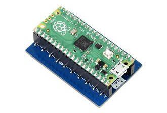
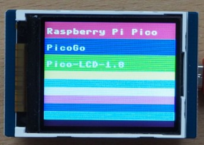

# Waveshare LCD 1.8

A 1.8 inch LCD display designed for the Pico

This small display has a dedicated socket on the back for a Pico. Use it to display colourful images.

## Preparation

Your pico should be running a version of Micropython. See [here](/resources/raspberrypi-pico-recipes/micropython) for details.

## Connect the Pico

Plug your Pico into the back of the display, making sure to place the USB connector on the end marked 'USB':

## Code

Pick up the code from Github and add it to your Pico.

[See code on github](https://github.com/lewfer/recipes-rpi-pico-micropython/blob/main/test_waveshare_pico_LCD_1.8.py)

Run the code. You should see some coloured rectangles and text:

## Reference

A full reference for this display can be found on the WaveShare website:

[WaveShare Pico LCD 1.8](https://www.waveshare.com/wiki/Pico-LCD-1.8)
