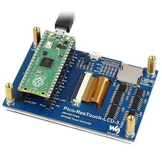
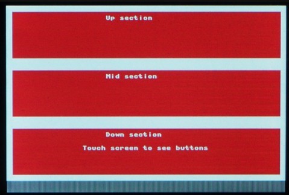
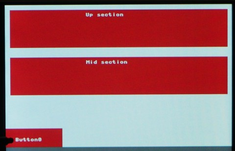

# Waveshare LCD 3.5

A 3.5 inch Touch Screen LCD display designed for the Pico

This display has a dedicated socket on the back for a Pico. Use it to display colourful images. It is a touch screen, so you can create interactive projects.

## Preparation

Your pico should be running a version of Micropython. See [here](/resources/raspberrypi-pico-recipes/micropython) for details.

## Connect the Pico

Plug your Pico into the back of the display, making sure to place the USB connector on the end marked 'USB':



## Code

Pick up the code from Github and add it to your Pico.

[See code on github](https://github.com/lewfer/recipes-rpi-pico-micropython/blob/main/test_waveshare_pico_LCD_3.5.py)

Run the code. You should see some red rectangles and text:



Press the screen and it will display some buttons. Press on a button to select it:



## Buffer Size Limitations

The code creates an image buffer in the memory on the Pico and then updates the display from this buffer. Unfortunately, the size of the buffer needed to hold the entire display area would require more memory than the Pico has. So instead we create a buffer for 1/3 of the screen at a time and then update 1/3 of the display at a time:

```python
    LCD.fill(LCD.WHITE)
    LCD.fill_rect(10,10,460,80,LCD.RED)
    LCD.text("Up section",170,17,LCD.WHITE)
    LCD.show_up()

    LCD.fill(LCD.WHITE)
    LCD.fill_rect(10,10,460,80,LCD.RED)
    LCD.text("Mid section",170,17,LCD.WHITE)
    LCD.show_mid()
    
    LCD.fill(LCD.WHITE)
    LCD.fill_rect(10,10,460,80,LCD.RED)
    LCD.text("Down section",170,17,LCD.WHITE)
    LCD.text("Touch screen to see buttons",130,40,LCD.WHITE)
    LCD.show_down()    

```

## Reference

A full reference for this display can be found on the WaveShare website:

[WaveShare Pico ResTouch LCD 3.5](https://www.waveshare.com/wiki/Pico-ResTouch-LCD-3.5)
