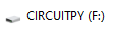

# CircuitPython on Raspberry Pi Pico

CircuitPython allows you to control a variety of components on the Raspberry Pi Pico.

CircuitPython is a version of the Python programming language designed to work on microcontroller boards such as the Raspberry Pi Pico.

## Install CircuitPython

To install CircuitPython on your Pico W, first download the latest version onto your computer from the official website: [Download CircuitPython for Raspberry Pi Pico W](https://circuitpython.org/board/raspberry_pi_pico_w/).

Note that if you are using the non-Wi-Fi Raspberry Pi Pico, you need a different UF2 file. Download it here: [CircuitPython for Raspberry Pi Pico](https://circuitpython.org/board/raspberry_pi_pico/).

With the Pico unplugged from power, press and hold the **BOOTSEL** button.

Whilst holding the BOOTSEL button, plug the Pico into a USB cable connected to your computer. You should see the **RPI-RP2** drive appear on your computer. Open Windows Explorer or Mac Finder to view it.

Now drag the UF2 file you downloaded onto the RPI-RP2 drive. The file will be copied to the Pico. After a short delay, a new drive called **CIRCUITPY** should appear.

> **Note:** CircuitPython is similar to, but different from, MicroPython. We recommend CircuitPython over MicroPython because it offers a wide range of libraries that make it easier to control many different components.

## Download the CircuitPython libraries

Various devices and services are supported by CircuitPython. You will need different libraries depending on the requirements of your project.

Download the latest CircuitPython library bundle from the [official CircuitPython libraries website](https://circuitpython.org/libraries).

Make sure you download the bundle that matches the version of CircuitPython you installed. For example, if you installed CircuitPython version 8.x, download the version 8.x library bundle.

Keep the bundle on your computer. You only need to copy the specific libraries required for your project, as explained in the subsequent worksheets.

## Download my CircuitPython samples

Examples are provided to accompany the subsequent worksheets. You can download the sample code from the [Raspberry Pi Pico CircuitPython recipes GitHub repository](https://github.com/lewfer/recipes-rpi-pico-circuitpython).

If you want to try all the example recipes, you can copy the entire set of files to your Pico's CIRCUITPY drive.

## Read the CircuitPython documentation

As you develop different projects, you will inevitably need some help.

Refer to the [official CircuitPython documentation](https://docs.circuitpython.org/en/latest/docs/index.html) for guidance, tutorials, and technical information.
