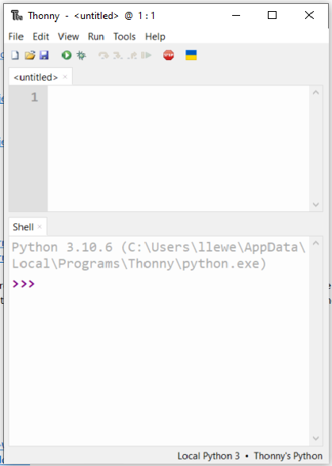
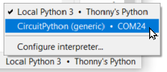
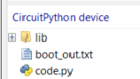
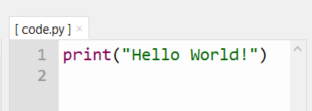

# Thonny with CircuitPython

Thonny is a Python IDE that makes running code on your Pico easy.

Thonny allows you to write Python code, save it on your Pico, and run it. This guide will show you how to use it with CircuitPython.

## Install Thonny

Download Thonny from the [official Thonny website](https://thonny.org/) and install it on your computer.

Turn on the option to view files.

Plug your Raspberry Pi Pico into your computer using a USB cable.

At the bottom-right corner of Thonny, select the **CircuitPython** option.

You should now see the files stored on your Pico.

## Run a Hello World program

Open the `code.py` file and enter the following code.

Run the code by pressing the **Run** button (the play icon).

You should see the result appear in Thonny.

**Note:** This code is running on the Raspberry Pi Pico, not on your computer!
