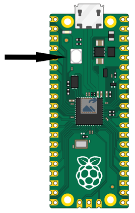
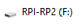

# MicroPython on Raspberry Pi Pico

MicroPython allows you to control a variety of components on the Raspberry Pi Pico.

MicroPython is a version of the Python programming language designed to work on microcontroller boards such as the Raspberry Pi Pico.

## Install MicroPython

To install MicroPython on your Pico W, first download the latest version onto your computer from the [official Raspberry Pi MicroPython documentation](https://www.raspberrypi.com/documentation/microcontrollers/micropython.html).

Make sure you download the Pico W version if you have a Pico W, and the non-W version if you have a standard Raspberry Pi Pico.

With the Pico unplugged from power, press and hold the **BOOTSEL** button.

While holding the BOOTSEL button, plug the Pico into a USB cable connected to your computer. You should see the **RPI-RP2** drive appear on your computer. Use Windows Explorer or Mac Finder to view it.

Now drag the UF2 file you downloaded onto the RPI-RP2 drive. The file will be copied to the Pico, and the drive should disappear from your computer.

> **Note:** MicroPython is similar to, but different from, CircuitPython. For many projects, we recommend CircuitPython because it offers a wider range of libraries, making it easier to control a variety of components. However, MicroPython may be a better choice for certain devices and features.

## Download my MicroPython samples

Examples are provided to accompany the subsequent MicroPython worksheets. You can download the sample code from the [Raspberry Pi Pico MicroPython recipes GitHub repository](https://github.com/lewfer/recipes-rpi-pico-micropython).

If you want to try all the example recipes, you can copy the entire set of files to your Pico.

## Getting Started with MicroPython on the Pico W

Here are the official getting-started guides for the Raspberry Pi Pico and Pico W.

**Note:** The standard blinking LED project in the original Pico guide may not work on the Pico W without modification because the onboard LED is controlled differently.

- [Getting Started with Raspberry Pi Pico](https://projects.raspberrypi.org/en/projects/getting-started-with-the-pico)
- [Getting Started with Raspberry Pi Pico W](https://projects.raspberrypi.org/en/projects/get-started-pico-w/0)
