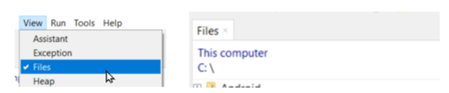
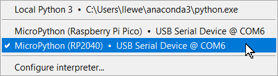
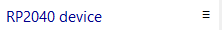
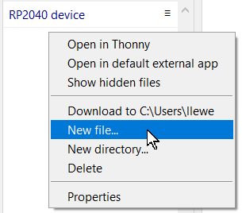
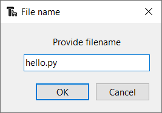
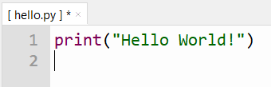
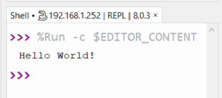

# Thonny with MicroPython

Thonny is a Python IDE that makes running code on your Pico easy.

Thonny allows you to write Python code, save it on your Pico, and run it. This guide will show you how to use it with MicroPython.

## Install Thonny

Download Thonny from the [official Thonny website](https://thonny.org/) and install it on your computer.


Turn on the option to view files.



Plug your Raspberry Pi Pico into your computer using a USB cable.

At the bottom-right corner of Thonny, select the **MicroPython** option.



You should see that there are no files currently on your Pico.



## Run a Hello World program

Create a new file by right-clicking in the files area.



Name the file `hello.py`.



Enter the following code.



Run the code by pressing the **Run** button (the play icon).


You should see the result appear in Thonny.



**Note:** This code is running on the Raspberry Pi Pico, not on your computer!

## Blink the Built-in LED

The Raspberry Pi Pico has a built-in LED that you can flash using Python code.

Create a new file called `blink.py` and enter the following code:

```python
# Blink the built-in LED

from machine import Pin
from time import sleep

led = Pin("LED", Pin.OUT)

for i in range(10):
    led.on()
    sleep(1)
    led.off()
    sleep(1)
```

Run this code. The built-in LED should flash **10 times**, staying on for one second and off for one second during each cycle.
