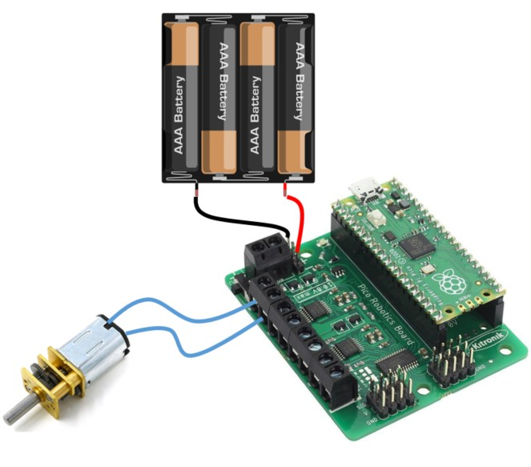

# DC Motors with the Kitronik Board

You can spin a DC motor in either direction and varying speed.

DC motors (or just “motors”) can spin when a current is applied. By reversing the current the motor spins in the opposite direction. By changing the voltage the motor spins faster or slower. The Kitronik robotics board handles the speed and direction control for us.

## Wire Up

Connect the two wires of the motor to the MOTOR1 connector on the Kitronik board. Connect a battery to the + and - connectors (+ to red) on the Kitronik board.



## Add the Library

You need to add the Kitronik extension. Copy the **PicoRobotics.py** file from the lib directory on github to the lib directory on the pico:


## Code

Write this code and download to the Pico.

[See code on GitHub](https://github.com/lewfer/recipes-rpi-pico-circuitpython/blob/master/test_kitronik_motor.py)

```python
# Test motor with kitronik robotics board

import PicoRobotics
import time

# Create robotics object
robot = PicoRobotics.KitronikPicoRobotics()


print("Forward")
for speed in range(0,100):
    robot.motorOn(1, "f", speed)
    time.sleep(0.1)


print("Reverse")
for speed in range(0,100):
    robot.motorOn(1, "r", speed)
    time.sleep(0.1)

print("Stop")
robot.motorOff(1)

```