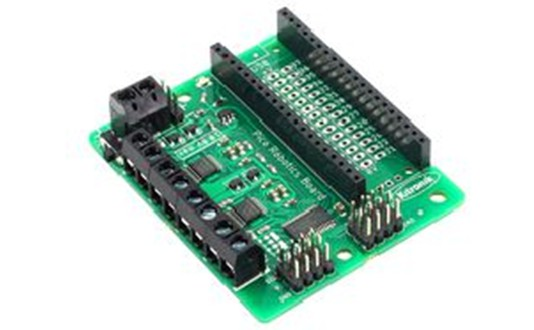
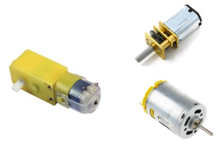
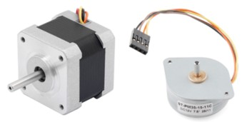
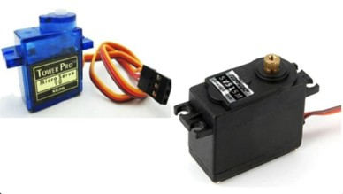

# Kitronik Robotics Board

The Kitronik Robotics Board is a really useful board for driving different types of motor.

Driving motors requires special circuitry. You can't just connect motors to the pins on the Pico board. The Kitronik Robotics Board provides the circuitry to drive a variety of motor types, so is a useful additionl to our digital making toolkit.

## DC Motors

These motors can spin continuously in either direction. There is usually some form of gearing to set the default speed and torque. The speed can be varied through software. They come in various shapes and sizes and usually have 2 wires. These wires can be connected directly to a battery, but you need circuitry, like the Kitronik board, to change the direction and speed.

DC motors are a great choice for wheeled robots.

You can connect them to MOTOR1 or MOTOR2 or MOTOR3 or MOTOR4 on the Kitronik board for up to 4 motors.

## Stepper Motors

Like DC motors, these motors can turn in either direction, but offer much more precision. You can control the precise number of steps the motor moves, and each step represents a precise angular turn. They usually have 4 wires. Voltages need to be applied to these wires in a precise sequence to drive the motor. The Kitronik board provides this driving sequence.

Stepper motors are used in devices like printers.

You can connect them to MOTOR1 and MOTOR2 or MOTOR3 and MOTOR4 on the Kitronik board for up to 2 motors.

## Servo Motors

Servo motors move to a specified angle, usually between 0 and 180 degrees. They are not as precise as stepper motors. They have 3 wires and require specific signals to move to different angles.

Servo motors are great for robotic creatures, indicators and other projects where a specific angular turn is required.

You can connect them to SV1 to to SV8 on the Kitronik board for up to 8 motors.

