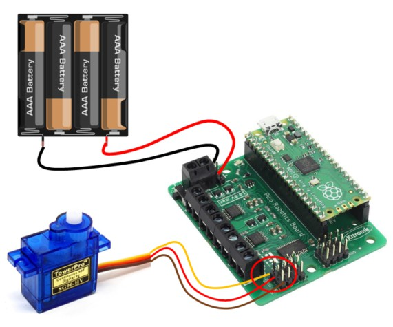

# Servo Motors with the Kitronik Board

Servo motors generally are design to move to any angle between 0 and 180 degrees.

Servo motors are great for robotic creatures, indicators and other projects where a specific angular turn is required.

## Wire Up

Connect the wire from the servo to the SERVOS 1 connector on the Kitronik board. Make sure the yellow wire connects to SIG and the brown wire to GND Connect a battery to the + and - connectors (+ to red) on the Kitronik board.



## Add the Library

You need to add the Kitronik extension. Copy the **PicoRobotics.py** file from the lib directory on github to the lib directory on the pico:


## Code

Write this code and download to the Pico.

[See code on GitHub](https://github.com/lewfer/recipes-rpi-pico-circuitpython/blob/master/test_kitronik_servo.py)

```python
# Test servo with kitronik robotics board

import PicoRobotics
import time

# Create robotics object
robot = PicoRobotics.KitronikPicoRobotics()

# Move servo 1 through different angles
robot.servoWrite(1, 20)
time.sleep(2)        
robot.servoWrite(1, 160)
time.sleep(2)        
robot.servoWrite(1, 90)

```

The motor should turn to the 3 angles.