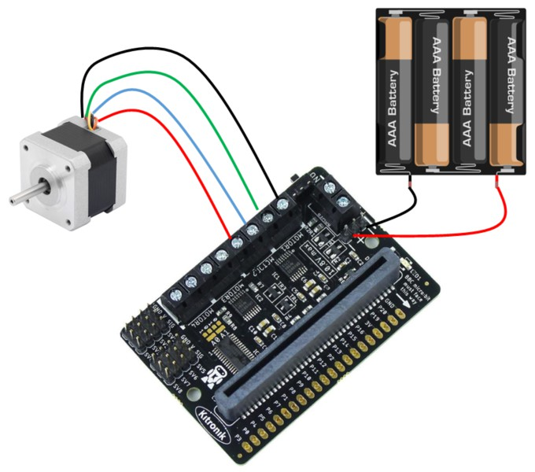
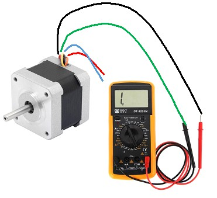

# Stepper Motors with the Kitronik Board

A stepper motor can move an exact number of steps, giving high precision.

Stepper motors give you a very precise movement of a number of steps. They are used in things like 3D printers, CNC machines, etc.

## Wire Up

Connect the 4 wires from the stepper to MOTOR1 and MOTOR2 in pairs. One pair goes to MOTOR1 and the other pair goes to MOTOR2.

Connect a battery to the + and - connectors (+ to red) on the Kitronik board.



> **Info:** If you are not sure which of the 4 wires are a pair, use a multimeter on the buzzer or resistance setting. You should get a buzz or 0 resistance on the wires that form a pair.



## Add the Library

You need to add the Kitronik extension. Copy the **PicoRobotics.py** file from the lib directory on github to the lib directory on the pico:


## Code

Ensure you have the Kitronik Robotics Board library added and then enter the following code:

[See code on GitHub](https://github.com/lewfer/recipes-rpi-pico-circuitpython/blob/master/test_kitronik_stepper.py)

```python
# Test stepper with kitronik robotics board

import PicoRobotics
import time


# Create robotics object
robot = PicoRobotics.KitronikPicoRobotics()

# Turn stepper 1 forward then backward
robot.step(1, "f", 50)
robot.step(1, "r", 50)

```