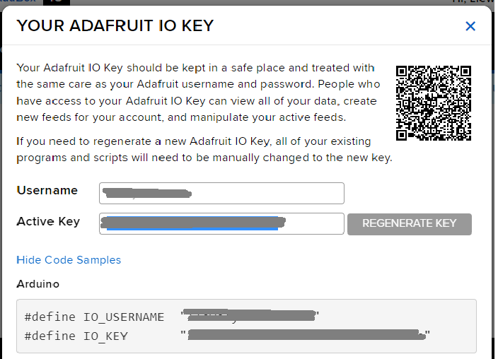

# IoT with Adafruit

Set up an IOT system by sending data from a Pico W to the Adafruit IO web service.

An Internet of Things (IoT) project allows network-connected devices to communicate with each other. This allows all sorts of possible projects, combining sensors, data, displays, web sites, all potentially working across the internet. Adafruit IO is a system that allows data from IoT devices to be collected and shared.

## Set Up Your Adafruit IO Account

Sign up for an Adafruit account at [io.adafruit.com](https://io.adafruit.com).

Get your username and key by clicking on the key:


Make a note of the username and key:



Add these details to your settings.toml file, e.g:

```toml
CIRCUITPY_WIFI_SSID="XXXXXX"
CIRCUITPY_WIFI_PASSWORD="YYYYYY"
aio_username="AAAAAA"
aio_key="BBBBBB"
```

Make sure to replace the XXXXX, YYYYYY, AAAAAA and BBBBBB with your particular settings.

Unplug your Pico from power and plug it back in for the settings to take effect.

## Add the Libraries

You need to add the relevant libraries. Copy the following from the lib directory on github to the lib directory on the pico:

```
adafruit_requests.mpy
adafruit_io
adafruit_minimqtt
```

## Code

Write this code and download to the Pico.

The following code snippet just sends some dummy data to Adafruit IO. You will want to change it to send your own data, e.g. from a temperatiure sensor.

[See code on GitHub](https://github.com/lewfer/recipes-rpi-pico-circuitpython/blob/master/test_iot_adafruit_io.py)

```python
# Test Adafruit IO 

import os
import time
import ssl
import microcontroller
import board
import busio
import adafruit_requests
from adafruit_io.adafruit_io import IO_HTTP, AdafruitIO_RequestError
import network

# Connect to wifi
net = network.Network()
net.connectWifi()

# Get Adafruit io credentials
aio_username = os.getenv('aio_username')
aio_key = os.getenv('aio_key')

# Initialize an Adafruit IO HTTP API object
pool = net.socketPool()
requests = adafruit_requests.Session(pool, ssl.create_default_context())
io = IO_HTTP(aio_username, aio_key, requests)
print("connected to io")

# Get or create a test feed
try:
    test_feed = io.get_feed("test")
except AdafruitIO_RequestError:
    test_feed = io.create_new_feed("test")

# Set up some dummy values
# Ultimately, these values will come from your sensor
data = [23,24,26,27,22,21,18]

# Send the data to Adafruit IO
for i in range(len(data)):
    try:
        # Get data value 
        value = data[i]
        print("Read value: ", value)
        
        # Send to Adafruit io
        io.send_data(test_feed["key"], value)
        time.sleep(1)

    # If any errors, reset Pico W
    except Exception as e:
        print("Error:\n", str(e))
        print("Resetting microcontroller in 10 seconds")
        time.sleep(10)
        microcontroller.reset()
    #  delay
    time.sleep(1)
```

## Reading the Data

Read the data by visiting your account page at [io.adafruit.com](https://io.adafruit.com) or write some code to pull the data. See [here](https://io.adafruit.com/api/docs/?shell#adafruit-io-http-api).

Or enter the following in your browser:

[https://io.adafruit.com/api/v2/AAAAAA/feeds/test/data?x-aio-key=BBBBBB](https://io.adafruit.com/api/v2/AAAAAA/feeds/test/data?x-aio-key=BBBBBB)

Make sure to replace the AAAAAA and BBBBBB with your particular settings.

## Further Reading

About Adafruit IO [About Adafruit IO](https://learn.adafruit.com/welcome-to-adafruit-io/what-is-adafruit-io)

[Setting up Adafruit IO for Pico W](https://learn.adafruit.com/pico-w-wifi-with-circuitpython/pico-w-with-adafruit-io)