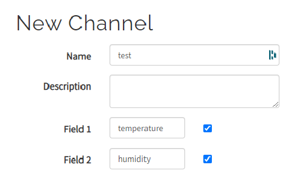
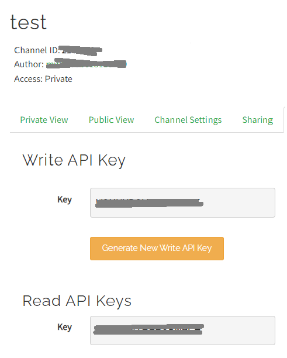

# IoT with ThingSpeak

Set up an IOT system by sending data from a Pico W to the ThingSpeak IO web service.

An Internet of Things (IoT) project allows network-connected devices to communicate with each other. This allows all sorts of possible projects, combining sensors, data, displays, web sites, all potentially working across the internet. ThingSpeak is a system that allows data from IoT devices to be collected and shared.

## Set Up Your ThingSpeak Account

Sign up for a ThingSpeak account at [io.adafruit.com](https://io.adafruit.com).

Create a new channel:


Add 2 new fields and save the channel:



Click on API Keys and get the Write and Read API Keys:



Add these details to your settings.toml file, e.g:

```toml
CIRCUITPY_WIFI_SSID="XXXXXX"
CIRCUITPY_WIFI_PASSWORD="YYYYYY"
THINGSPEAK_CHANNEL_ID=123456
THINGSPEAK_WRITE_API_KEY="AAAAAA"
THINGSPEAK_READ_API_KEY="BBBBBB"
```

Make sure to replace the XXXXX, YYYYYY, 123456, AAAAAA and BBBBBB with your particular settings.

Unplug your Pico from power and plug it back in for the settings to take effect.

## Add the Libraries

You need to add the relevant libraries. Copy the following from the lib directory on github to the lib directory on the pico:

```
adafruit_requests.mpy
```

## Code

The following code snippet just sends some dummy data to ThingSpeak. You will want to change it to send your own data, e.g. from a temperature and humidity sensor.

[See code on GitHub](https://github.com/lewfer/recipes-rpi-pico-circuitpython/blob/master/test_iot_thingspeak.py)

```python
# ThingSpeak iot test

import os
import time
import ssl
import adafruit_requests
import network

# Connect to wifi
net = network.Network()
net.connectWifi()

# Get Adafruit io credentials
THINGSPEAK_WRITE_API_KEY = os.getenv('THINGSPEAK_WRITE_API_KEY')

# Initialize an Adafruit IO HTTP API object
pool = net.socketPool()
requests = adafruit_requests.Session(pool, ssl.create_default_context())

# Create an http connection to talk to api
http = adafruit_requests.Session(pool)
   
# Create a URL to write data
url = "http://api.thingspeak.com/update?api_key=" + THINGSPEAK_WRITE_API_KEY

# Write data
response = http.post(url,data={"field1":100,"field2":200,"field3":300})

# Close the connection
response.close()
```

## Reading the Data

Read the data by entering the following in your browser:

[https://api.thingspeak.com/channels/123456/feeds.json?api_key=BBBBBB](https://api.thingspeak.com/channels/123456/feeds.json?api_key=BBBBBB)

Make sure to replace the 123456 and BBBBBB with your particular settings.

## Further Reading

Visit [https://thingspeak.com/](https://thingspeak.com/) for more details on ThingSpeak.