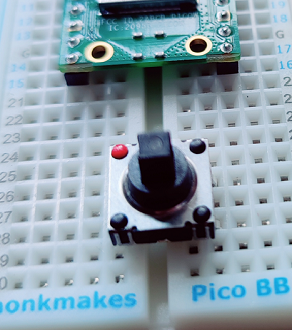
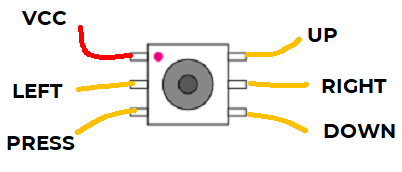

# 5 Way Navigation Switch

These tiny devices have 5 buttons, giving you a mini joystick.

This device is 5 buttons in one. There are up, down, left and right buttons and a press button in the middle. You can make a very simple joystick control with these.

## Wire Up (Pull Down)

Place the switch on a breadboard like this. You need to place it across the channel in the middle of the breadboard and make sure the legs of the switch go into the holes without bending.



Connect the switch as follows.



| Joystick | Pico |
|---|---|
| Red | 3V3 |
| UP | GP16 |
| DOWN | GP17 |
| LEFT | GP18 |
| RIGHT | GP19 |
| PRESS | GP20 |

## Code

Write this code and download it to the Pico. Press each button in turn and confirm the correct message is shown.

[See code on GitHub](https://github.com/lewfer/recipes-rpi-pico-circuitpython/blob/master/test_5_way_nav_switch.py)

```python id="mq6w0v"
# Test 5-way navigation switch

import time
from digitalio import DigitalInOut, Direction, Pull
import board
import network

# Set up the buttons
up = DigitalInOut(board.GP16)
up.direction = Direction.INPUT
up.pull = Pull.DOWN  # Pull down so button value is True when pressed

down = DigitalInOut(board.GP17)
down.direction = Direction.INPUT
down.pull = Pull.DOWN  # Pull down so button value is True when pressed

left = DigitalInOut(board.GP18)
left.direction = Direction.INPUT
left.pull = Pull.DOWN  # Pull down so button value is True when pressed

right = DigitalInOut(board.GP19)
right.direction = Direction.INPUT
right.pull = Pull.DOWN  # Pull down so button value is True when pressed

press = DigitalInOut(board.GP20)
press.direction = Direction.INPUT
press.pull = Pull.DOWN  # Pull down so button value is True when pressed

# Check buttons
while True:
    print(".")
    if up.value:
        print("up")
    elif down.value:
        print("down")
    elif left.value:
        print("left")
    elif right.value:
        print("right")
    elif press.value:
        print("press")
    time.sleep(0.1)
```
