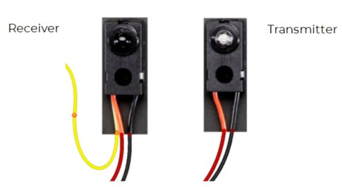

# Break Beam Sensor

A break beam sensor can be used to detect if an object passes through a particular point.

An infrared break-beam sensor sends an invisible beam of infrared light from the transmitter to the receiver. If some object (such as an intruder) comes between the transmitter and the receiver, the receiver sends a signal.

## Wire Up

Connect the sensor as follows:



| Circuit | Pico |
|---|---|
| Red cables | 3V3 |
| Black cables | GND |
| Yellow cable | GP18 or another GP pin |

Point the two parts of the sensor towards each other. One part sends the beam, and the other part receives the beam. Placing something between the parts breaks the beam.

## Code

Create the following code and download it to the Pico (this is the same code as for the button).

[See code on GitHub](https://github.com/lewfer/recipes-rpi-pico-circuitpython/blob/master/test_button_pull_down.py)

```python id="3tb2ma"
# Test button input (button connected to 3V3)

import board
from digitalio import DigitalInOut, Direction, Pull
import time

# Set up the button on pin 18 as a digital input pin
switch = DigitalInOut(board.GP18)
switch.direction = Direction.INPUT
switch.pull = Pull.DOWN  # Pull down so button value is True when pressed

# Show the button status (True is pressed, False is not pressed)
while True:
    print(switch.value)
    time.sleep(0.01)
```

The output will change according to whether the beam is broken or not.
