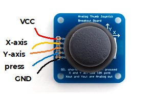
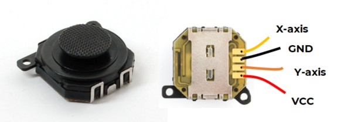

# XY Joystick with Button

An XY joystick can give a reading in both the X and Y directions.

These joysticks can register movement in the left-right direction (X) and up-down direction (Y). This gives great flexibility for controlling things like robots, games, etc. There are different types of joystick, but they mostly work in the same way. You may need to experiment with the exact values for your particular joystick. Generally, the values for each axis are between 0 and 65535, but the orientation and exact range will vary. Some joysticks also have a button function.

## Wire Up (Pull Down)

Connect the joystick as follows. Note that not all joysticks have a button press function:





| Joystick | Pico |
|---|---|
| Red | 3V3 |
| Black | GND |
| X-axis | GP28 / A2 |
| Y-axis | GP27 / A1 |
| Press | GP18 or another GP pin |

## Code

Write this code and download it to the Pico. Move the joystick and press the button. Readings should be roughly in the range -32768 to +32768 for both the X and Y axes.

[See code on GitHub](https://github.com/lewfer/recipes-rpi-pico-circuitpython/blob/master/test_joystick_xy.py)

```python id="8cmvsc"
# Test XY Joystick with button

import time
import board
import analogio
from digitalio import DigitalInOut, Direction, Pull

# Set up axes on pins 27 and 28 as analogue input pins
axis1 = analogio.AnalogIn(board.GP27_A1)
axis2 = analogio.AnalogIn(board.GP28_A2)

# Set up the button on pin 18 as a digital input pin
press = DigitalInOut(board.GP18)
press.direction = Direction.INPUT
press.pull = Pull.UP  # Pull up - button True when not pressed

# Value will be 0 to 65535 (direction of increase/decrease depending on the order of black/red wires)
while True:
    val1 = axis1.value - 32767
    val2 = axis2.value - 32767
    print(val1, val2, press.value)
    time.sleep(0.2)
```
