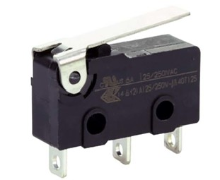
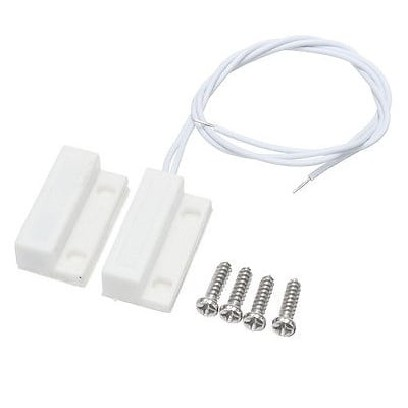
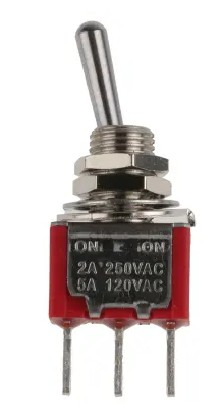

# Other Switches

Switches come in a variety of forms.

Knowing how to wire and code a button opens up lots of possibilities for using the variety of switches and buttons out there!

## Some Examples

Microswitches can be used in machines or robots to detect a "crash", where something hits something else!

Magnetic contact switches can be used to detect if a door is opened:

Toggle switches can be set on or off:

## Coding

See [the digital input example](../digital-input-button) for details of how to code them.
