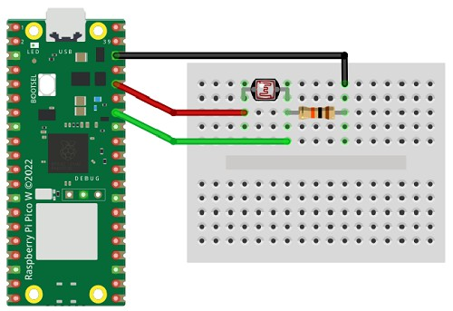

# Photocell

A photocell can be used to detect light levels.

A photocell (also called a light dependent resistor, LDR, or photoresistor) varies its resistance depending on the amount of light falling on it.

## Wire Up

Wire up the photocell using a 10 kΩ resistor like this:



| Circuit | Pico |
|---|---|
| Red | 3V3 |
| Black | GND |
| Green | GP28 or another Analogue Pin |

## Code

Write this code and download to the Pico.

[See code on GitHub](https://github.com/lewfer/recipes-rpi-pico-circuitpython/blob/master/test_ldr.py)

```python
# Test LDR (Light Dependent Resistor, sometimes called a photocell)

import time
import board
import analogio

# Set up the LDR on pin 28 as an analogue input pin
photocell = analogio.AnalogIn(board.GP28_A2)

# Value will be 0 to 65535 (0 for bright, 65535 for dark or vice versa depending on the order of black/red wires)
while True:
    val = photocell.value
    print(val)
    time.sleep(.2)
```

Now vary the amount of light falling on the LDR and watch the output change.

**Can you create a light (using an LED) that shines brighter when the light levels in the room fall?**
