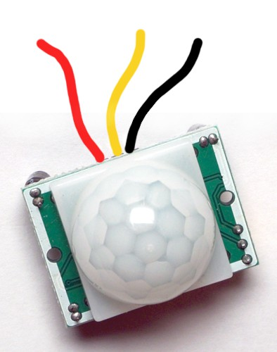
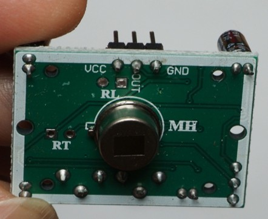
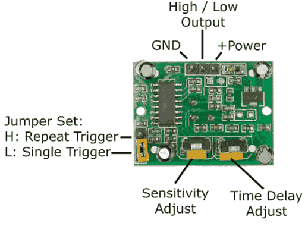

# PIR (Passive Infrared)

PIRs are used to detect human presence, for example in burglar alarms.

A PIR detects infrared radiation (it does it passively, so it’s called a Passive Infrared or PIR). The hotter something is, the more IR radiation it emits. PIRs can detect when the amount of IR radiation changes in their zone of detection.

## Wire Up

Connect the sensor as follows. You can pop off the dome to reveal the pin labels!





| Sensor | Pico |
|---|---|
| VCC | 3V3 |
| Black | GND |
| OUT | GP16 or another GP pin |

## Code

Write this code and download to the Pico.

[See code on GitHub](https://github.com/lewfer/recipes-rpi-pico-circuitpython/blob/master/test_pir.py)

```python
# Test PIR

import board
from digitalio import DigitalInOut, Direction, Pull
import time

# Set up the button on pin 16 as a digital input pin
pir = DigitalInOut(board.GP16)
pir.direction = Direction.INPUT
pir.pull = Pull.DOWN

# Wait for intruders
while True:
    if pir.value:
        print("Intruder!")
        while pir.value:
            pass
    print("Waiting")
    time.sleep(0.1)
```

Cover the sensor with a cup (not your hands, which are warm and will trigger the sensor!). Wait around 60 seconds for the PIR to warm up. The output should show "Waiting". Then uncover the sensor. It should detect you and display "Intruder!".

## Adjust

You may need to adjust sensitivity and the time delay if the PIR does not respond correctly. You can do this by turning the little screw adjustments on the PIR. See [here](https://www.electronicwings.com/sensors-modules/pir-sensor) for more guidance.



Sensitivity adjusts clockwise for higher sensitivity and anticlockwise for lower sensitivity. Time delay adjusts clockwise for longer and anticlockwise for shorter.
