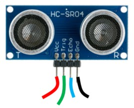
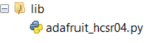

# Ultrasonic

An ultrasonic sensor can be used to measure distance to a solid object.

An ultrasonic sensor measures distance by emitting an ultrasound signal and timing how long it takes for the signal to return. This is just like the method that bats use to navigate!

## Wire Up

Connect the sensor as follows:



| Sensor | Pico |
|---|---|
| Red | 3V3 |
| Black | GND |
| Echo | GP6 or another GP pin |
| Trig | GP7 or another GP pin |

## Add the Library

You need to add the HCSR04 library. Copy **`adafruit_hcsr04.py`** from the `lib` directory on GitHub to the `lib` directory on the Pico.



## Code

Write this code and download to the Pico.

[See code on GitHub](https://github.com/lewfer/recipes-rpi-pico-circuitpython/blob/master/test_ultrasonic.py)

```python id="c1um2a"
# Test ultrasonic distance sensor

import time
import board
import adafruit_hcsr04

# Create the sonar object connected to the given pins
sonar = adafruit_hcsr04.HCSR04(trigger_pin=board.GP6, echo_pin=board.GP7)

# Display the distance measurement
while True:
    try:
        print(sonar.distance)
    except RuntimeError:
        print("Error")
    time.sleep(0.1)
```

Run the code and see the distance measurements in the output window. Move your hand in front of the sensor. The distance measurement should change accordingly.
