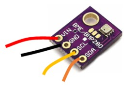
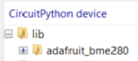

# Weather Sensor

The BME280 weather sensor can read temperature, pressure and humidity.

These handy little weather sensors come in different forms. They are a simple way to add weather sensing capabilities to your project.

## Wire Up

Connect the sensor as follows.



| Sensor | Pico |
|---|---|
| VIN | 3V3 |
| GND | GND |
| SCL | GP5 or other SCL pin |
| SDA | GP4 or other SDA pin |

## Add the Library

You need to add the BME280 library to your project.

Copy the `adafruit_bme280` directory from the `lib` directory on GitHub to the `lib` directory on the Pico.



## Code

Write this code and download it to the Pico.

[See code on GitHub](https://github.com/lewfer/recipes-rpi-pico-circuitpython/blob/master/test_bme280.py)

```python
# Test BME280 weather sensor

import time
import board
import busio
from adafruit_bme280 import basic as adafruit_bme280

# Create sensor object, using the GP4/GP5 I2C bus
i2c = busio.I2C(board.GP5, board.GP4)  # SCL, SDA
bme280 = adafruit_bme280.Adafruit_BME280_I2C(i2c, 0x76)

# Change this to match the location's pressure (hPa) at sea level
# This calibrates the altitude measurement to 1m accuracy
bme280.sea_level_pressure = 1013.25

while True:
    print("\nTemperature: %0.1f C" % bme280.temperature)
    print("Humidity: %0.1f %%" % bme280.relative_humidity)
    print("Pressure: %0.1f hPa" % bme280.pressure)
    print("Altitude = %0.2f meters" % bme280.altitude)
    time.sleep(2)
```

You should see the weather readings. Raise the temperature by placing your hands over the sensor, and raise the humidity by breathing on the sensor.

Note that the altitude readings depend on calibration of the pressure. Check the documentation for details.

## Further Reading

More documentation can be found [in the CircuitPython documentation here](https://docs.circuitpython.org/projects/bme280/en/latest/index.html).
