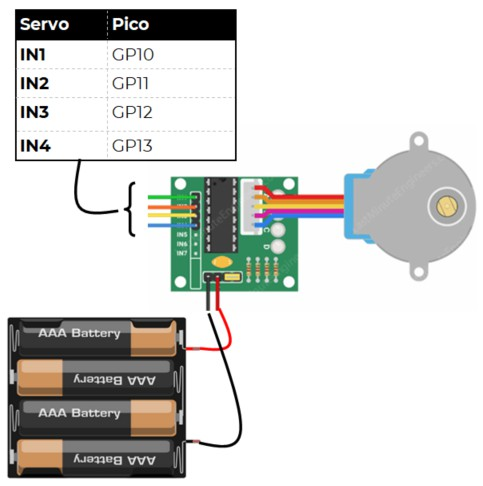

# Hobby Stepper (28BYJ-48)

This cheap stepper motor can move a number of steps with a reasonable degree of precision.

Stepper motors can be expensive. A cheap option is the 28BYJ-48. It can’t be driven from the standard motor connections on the Kitronik board, but it comes with its own motor driver board.

## Wire Up

Connect the stepper as follows:



## Add the Library

You need to add the stepper-motor library. Copy **stepper_28BYJ48.py** from the lib directory on github to the lib directory on the pico.


## Code

Enter and run the following code:

[See code on GitHub](https://github.com/lewfer/recipes-rpi-pico-circuitpython/blob/master/test_stepper_28BYJ-48.py)

```python
# Test the 28BYJ-48 stepper

import time
import board
import stepper_28BYJ48

# Create the stepper object
stepper = stepper_28BYJ48.Stepper(board.GP10, board.GP11, board.GP12, board.GP13)

# Move forwards and backwards
numSteps = 100
stepper.forward(numSteps)
stepper.backward(numSteps)
stepper.smoothForward(numSteps)
stepper.smoothBackward(numSteps)

```

The motor should move forwards and backwards 100 steps, then repeat in smooth mode.