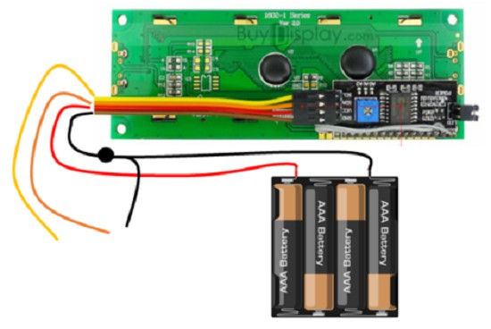
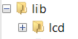

# LCD Display

These LCD displays can show text.

These displays are usually able to display 16 characters per line on 2 lines (16x2), but other formats (notably 20x4) are also available.

## Wire Up

Connect to the Pico as follows:



| Circuit | Connection |
|---|---|
| VCC | Battery + |
| GND | Pico GND |
| GND | Battery - |
| SCL | Pico GP5 or other SCL pin |
| SDA | Pico GP4 or other SDA pin |

> **Note:** The black connector needs to be split to both the battery and the Pico. You can do this via a breadboard.

## Add Library

You need to add the LCD library. Copy the **`lcd`** folder from the `lib` directory on GitHub to the `lib` directory on the Pico.



## Code

Write this code and download it to the Pico.

[See code on GitHub](https://github.com/lewfer/recipes-rpi-pico-circuitpython/blob/master/test_lcd_16x2.py)

```python id="0e9kfd"
# 16x2 character LCD test

import board
import busio
import time
from lcd.lcd import LCD, CursorMode
from lcd.i2c_pcf8574_interface import I2CPCF8574Interface

# Set up LCD display
i2c = busio.I2C(board.GP5, board.GP4)  # SCL, SDA
interface = I2CPCF8574Interface(i2c, 0x27)
lcd = LCD(interface, num_rows=2, num_cols=20)
lcd.set_cursor_mode(CursorMode.HIDE)
lcd.set_backlight(1)

# Single line
lcd.clear()
lcd.print("abcdefghijklmnop")
time.sleep(2)

# Double line
lcd.clear()
lcd.print("Line 1\nLine 2")
time.sleep(2)

# Position
lcd.clear()
lcd.set_cursor_pos(1, 4)
lcd.print("Here I am")
time.sleep(2)
```
