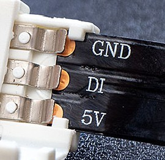

# Neopixels

Neopixels are multicoloured strips of LEDs, where each LED can be individually controlled.

Use neopixels to add impressive light displays or data visualisations to your project.

## Wire Up

The colours of the wires can vary, so check the lettering on the end of the neopixel strip to connect correctly. Connect to the Pico as follows:



| Circuit | Pico |
|---|---|
| 5V | 3V3 |
| Black | GND |
| DI or DIn | GP2 or another GP pin |

## Add the Library

You need to add the neopixel library. Copy **`neopixel.py`** from the `lib` directory on GitHub to the `lib` directory on the Pico.


## Code

Write this code and download it to the Pico.

[See code on GitHub](https://github.com/lewfer/recipes-rpi-pico-circuitpython/blob/master/test_neopixel.py)

```python
# Test neopixel

import board
import neopixel

# Set the number of pixels connected
num_pixels = 30

# Create the neopixel object
pixels = neopixel.NeoPixel(board.GP22, num_pixels)

# Set the brightness level (from 0 to 1)
pixels.brightness = 1

# Set the colours of all pixels
pixels.fill((255, 0, 0))

# Set the colours of pixels individually
pixels[0] = (0, 255, 0)  # green
pixels[1] = (0, 0, 255)  # blue
pixels[2] = (255, 255, 255)  # white
```

## Further Reading

The library documentation can be found [here](https://docs.circuitpython.org/projects/neopixel/en/latest/index.html).

The original library can be found [here](https://github.com/adafruit/Adafruit_CircuitPython_NeoPixel).
