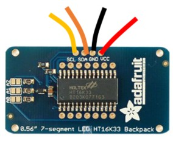
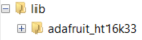

# Numeric Display

These numeric displays can be used to display up to 4 digits.

## Wire Up

Wire up the display as follows:



| Display | Pico |
|---|---|
| VCC | 3V3 |
| GND | GND |
| SCL | GP5 or another SCL pin |
| SDA | GP4 or another SDA pin |

## Add the Library

You need to add the Numeric LED library. Copy the **`adafruit_ht16k33`** folder from the `lib` directory on GitHub to the `lib` directory on the Pico.



## Code

Write this code and download it to the Pico.

[See code on GitHub](https://github.com/lewfer/recipes-rpi-pico-circuitpython/blob/master/test_led_7segment.py)

```python id="3ns8pu"
# Test 7 segment LED display

import board
import busio as io
import time
import adafruit_ht16k33.segments

# Create display object
i2c = io.I2C(board.GP5, board.GP4)  # SCL, SDA
display = adafruit_ht16k33.segments.Seg7x4(i2c, address=0x70)

# Clear
display.fill(0)

# Display individual characters
display[0] = '8'
display[1] = '7'
display[2] = 'a'
display[3] = 'm'  # Some characters can't display
display.show()
time.sleep(2)

# Display number
display.print(1234)
display.show()
time.sleep(2)

# Display letters
display.print('DEAL')
display.show()
time.sleep(2)
```
